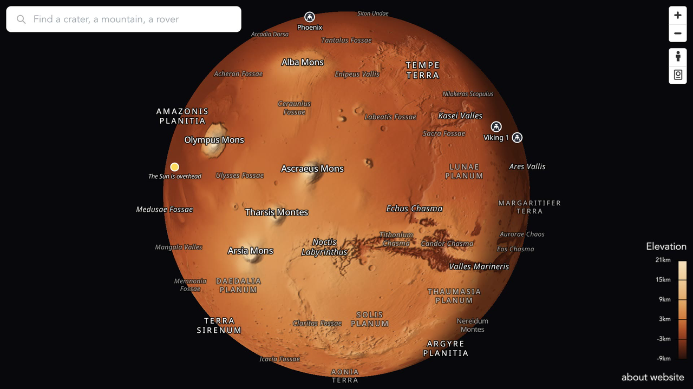

# Map of Mars

This is an interactive map of Mars: https://anvaka.github.io/mars/

[](https://anvaka.github.io/mars/)

# Details

The map was made from a [publicly available digital elevation model](https://astrogeology.usgs.gov/search/map/Mars/Topography/HRSC_MOLA_Blend/Mars_HRSC_MOLA_BlendDEM_Global_200mp_v2). 
Maximum resolution of the model is 200 meters per pixel.

The map is rendered by [MapLibre GL JS](https://maplibre.org/maplibre-gl-js/docs/). Its `color-relief` layer
turns the elevation tiles into colors. The map is a globe when zoomed out, and it flattens as you zoom in.

## Data

* **Elevation** is stored as 16 bit tiles in a single [PMTiles](https://docs.protomaps.com/pmtiles/) file, hosted
  on Cloudflare R2. `tools/build_dem_tiles.py` makes that file from the elevation model above. The address of the
  file is set by `VITE_DEM_PMTILES` in the `.env` file.

  The website does not read that file directly: a small Cloudflare Worker (`tools/tiles-worker`) sits next to the
  bucket and gives the tiles out one by one, so that they can be cached. It is several times faster. Its address is
  `VITE_DEM_TILES`, and if it does not answer, the website reads the file itself. To publish the worker:

  ```
  npx wrangler deploy --config tools/tiles-worker/wrangler.toml
  ```

  The same worker passes along the photos of the rovers, see "Standing on Mars" below.

  The caches keep a tile forever. When the tiles are built again, upload them under a new name
  (`mars-dem-v2.pmtiles`) and change both addresses in `.env`.
* **Detailed elevation** exists for the two places where the rovers drive: Gale crater (Curiosity) and Jezero
  crater (Perseverance). There a height is known every meter, not every 200 meters. `tools/build_detail_dem_tiles.py`
  turns the models published by USGS into two more PMTiles files (a pixel is 2.5 meters, about 350MB together),
  which live in the same bucket and are given out by the same worker. Their addresses are listed in
  `VITE_DEM_DETAIL_TILES`. Only the ground view uses them.
* **Names** come from the [Gazetteer of Planetary Nomenclature](https://planetarynames.wr.usgs.gov/Page/MARS/target).
  `tools/build_labels.py` turns them into the files in `public/data`, see "Names" below.
* **Fonts** are in `public/fonts`.

## Names

All the names of the gazetteer are on the map, and each of them can be clicked. The card of a feature shows:

* a picture and a few sentences from its Wikipedia article, when there is one (about a third of the features,
  and more than a half of those that are larger than 100 km). They are loaded from Wikipedia when the card opens;
* what kind of feature it is in plain words (the gazetteer says "Mons", the card says "Mountain"), and its size;
* its highest and lowest points, measured from the elevation tiles;
* where the name comes from.

A line goes around the feature to show its size. The search finds any feature by name, including the landing
sites and the regions of the old telescope maps (Tharsis, Elysium), which have no label of their own. The chosen
feature is kept in the address bar (`?feature=4453`), so it can be shared.

The names do not all look the same, otherwise the few that people look for would drown among the two thousand:

* **Missions** are badges, not just words, and are seen from any distance (`src/lib/missionIcons.js`). The four
  rovers whose photos the website can show have a large pink badge, and their card has the button "See what it saw":
  it takes you to the place where the rover is now. Landers, and the rover without photos, have a small dark badge.
* **Landmarks** are the features that people read about. `tools/count_wikipedia_readers.py` counts how many times
  a month the Wikipedia article of each feature is read, and saves it to `tools/wikipedia_readers.json`. A name with
  at least 100 readers (57 of them: Olympus Mons, Valles Marineris, Gale, Jezero) is drawn brighter and larger, wins
  when two names do not fit together, and appears earlier than its size allows.
* **All the other names** are a little transparent. They are still there, and can be clicked.

```
uv run tools/count_wikipedia_readers.py tools/wikipedia_articles.json tools/wikipedia_readers.json
```

`tools/build_labels.py` makes two files: the labels of the map (`public/data/mars-labels.geojson`), and the
details for the cards and the search (`public/data/mars-features.json`), which is loaded when first needed.
`tools/find_wikipedia_articles.py` finds which article tells about which feature. It asks Wikidata, which knows
the gazetteer number of many features, and saves the answer to `tools/wikipedia_articles.json`.

## Light

The slopes are shaded, so that craters and canyons look like land and not like a color chart. The globe shows where
the Sun is over Mars right now, and the land is lit by that very Sun (`src/lib/sunRelief.js`): shadows are long near
the edge of the night and almost gone where the Sun is overhead. The shade is drawn in the browser from the elevation
tiles, and drawn again as the Sun moves. When the map is drawn as ridgelines, the light comes from the top left
corner, the way it does on printed maps.

The `OCHRE` theme is made to go with the shading, and it is the one the map opens with.

## Ridgelines

The button with three ridges, under the zoom buttons, draws what is on the screen as lines of elevation, one behind
the other. This is the picture that can be printed on a mug. Its options (how many lines, how tall, which colors)
are shown only while the lines are drawn, so the map itself has no settings: the colors of the map change with a
click on the elevation legend.

## Standing on Mars

Click the figure button on the map, and then a place: the website puts you on the surface. The land around you
is drawn from the same elevation tiles (`src/ground`), so it is as detailed as the data is - 200 meters. Hills
and craters are there, rocks are not.

* **Where the rovers drive** the land is drawn from the detailed elevation (see "Data"), with a height every
  2.5 meters: buttes, ridges and channels have their true shape, and the drawn land matches the photos of the
  rovers. The detailed land is loaded only around you, and follows you as you walk (`src/ground/loadTerrainPatch.js`).
* **The land is painted with photos taken from the orbit** (`src/ground/loadImagery.js`). Everywhere on the
  planet it is the black and white mosaic of the Context Camera made by the
  [Murray Lab](https://murray-lab.caltech.edu/CTX/) (5 meters per pixel, served by Esri). Around the rovers it is
  the color mosaic of the HiRISE camera (25 centimeters per pixel) from NASA's rover maps. The photos are loaded
  from those servers by the visitor's browser. Their brightness and color are evened out, and moved towards the
  color of the dust: color photos from the orbit are not what an eye would see. A hollow is also drawn darker than
  a hilltop, which keeps the land readable at noon, when nothing casts a shadow.

* **The Sun** is where it is over that place right now. `src/lib/marsTime.js` implements the
  [Mars24 algorithm](https://www.giss.nasa.gov/tools/mars24/help/algorithm.html) for that. The same clock shades
  the night side of the globe.
* **Routes of the rovers** appear when you zoom close to them. For Perseverance and Curiosity they come straight
  from the files of NASA's own ["Where is the rover"](https://science.nasa.gov/mission/mars-2020-perseverance/location-map/)
  maps, along with the photos of the land taken from the orbit. Spirit and Opportunity do not drive anymore, and
  have no such maps: their routes and the lists of their photos are made once from the archives of the Planetary
  Data System by `tools/build_rover_archive.py`, and are stored in `public/data/rovers`.
* **Photos**. Click a stop on the route to see what the rover saw from there. The photos are raw images of
  the navigation cameras, loaded from NASA when you ask for them. Each one comes with a description of the camera
  (`src/ground/cameraModel.js`), which tells where every pixel was looking at. The photos of Spirit and
  Opportunity are loaded from the archive itself, which lets a website read them.

  The photos do not cover everything, and the drawn sky and land are seen between them. While the photos are
  shown, the sky takes their color, and under black and white photos the land is drawn black and white too.

  The photos of one stop do not match each other: they are taken at different hours, each with its own exposure,
  and the lens makes every photo darker to its sides. So the website evens them out before it shows them
  (`src/ground/createPhotoSphere.js`): it undoes the darkening of the lens, finds the exposure of every
  photo from the places that two neighbor photos both see (`src/ground/matchExposure.js`), and lets the sides of
  the photos fade one into another.

  How much a lens darkens was measured on the same shared places: the camera of Perseverance loses a half of the
  brightness at the sides, and those of Curiosity, Spirit and Opportunity lose a third at the sides and almost
  a half in the corners. `tools/measure_vignette.py` does the measuring for the last three:

  ```
  uv run tools/measure_vignette.py public/data/rovers/MERA-photos.json data/mer/browse
  uv run tools/measure_vignette.py msl:650,1100,1700,2300,2900,3400,800,1400,2000,2600,3100,3700 data/msl/browse
  ```

  To do this the website has to read pixels of the photos, and NASA does not let other websites do it. So the
  photos are asked through the same Cloudflare Worker that gives the elevation tiles: it passes them along and
  adds the permission. Its address is `VITE_PHOTO_PROXY` in the `.env` file, and without it the ground view has
  no photos.
* **Arrows**. Two arrows lie on the ground at a stop: the bright one points to the next stop of the rover,
  the pale one to the previous. Click an arrow to go there.
* **Sounds**. A few stops of Perseverance have recordings of its microphones, see `src/lib/roverSounds.js`.
  Such a stop is marked with a yellow note on the map, and the recording can be played once you stand there.
  The four recordings are copies of the files that NASA has published, kept in the folder `sounds` of the same
  R2 bucket that holds the elevation. `VITE_SOUNDS` in the `.env` file is the address of that folder; without
  it the recordings are played from the website of NASA.
* **The small map**. The map does not go away when you stand on the surface: it shrinks into the corner
  (`src/lib/miniMap.js`). A blue dot with a beam shows where you are and where you look. It is the very same
  map, so it has the routes and the stops of the rovers: click a stop to go there, or any other place to stand
  on it. A stop is a small dot, so a click within 14 pixels of one counts as a click on it. The button in its corner makes the map larger.

Almost nothing of the above is stored in this repository: the routes are requested from NASA servers by the
visitor's browser, and the photos come from NASA through the worker, which keeps them in the Cloudflare cache.
The exception is the routes and the lists of photos of Spirit and Opportunity (5MB in `public/data/rovers`).

Without `VITE_DEM_PMTILES` the website falls back to the original 8 bit elevation tiles hosted by MapBox. Open
http://localhost:8080/tools/compare.html during development to see both side by side.

# Patronage

If you like this work please consider sponsoring the project:

* [Via PayPal](http://paypal.me/anvakos/4)
* [Via GitHub Sponsors](https://github.com/sponsors/anvaka)

Your support will be used to pay for MapBox hosting services and further development of this project ❤️.

# Local development

```
npm install
npm start
```

Note: the code still imports a MapBox token for the fallback elevation tiles, so the file `src/token.js` has to
exist:

``` js
export const MAPBOX_TOKEN = '... your mapbox token, or an empty string ...';
```

The dev server always runs on http://localhost:8080.

To build the website into the `dist` folder run `npm run build`.

# License

The source code is licensed under MIT license.